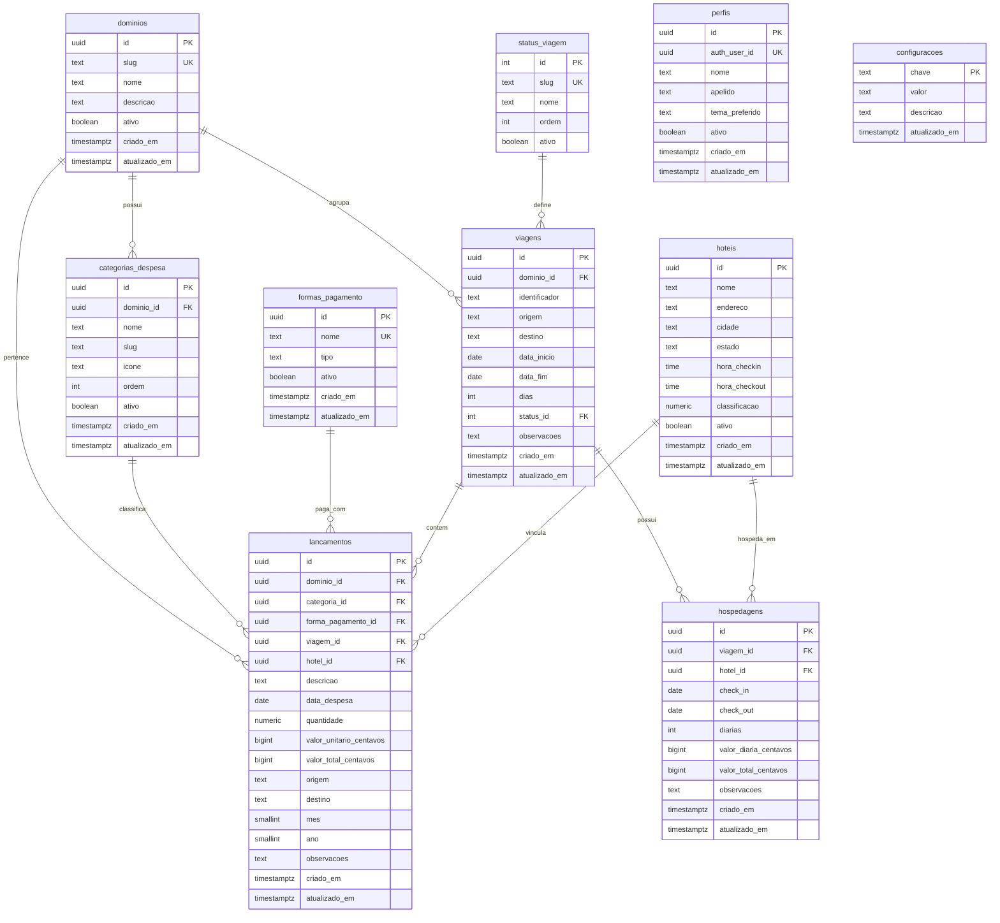
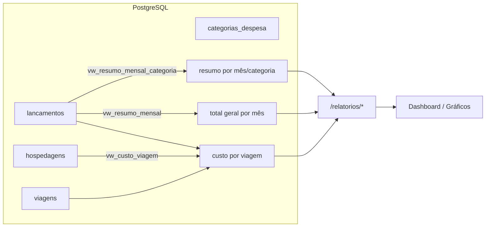

# MetricDash — Diagrama ER (português)

Diagrama entidade-relacionamento do banco de dados, baseado em `docs/setup-database/panel-finance-itau.md`. Todos os elementos em português.

**Motor:** PostgreSQL (Supabase) · **Valores:** centavos (`bigint`) · **Render:** Mermaid `erDiagram`.

## Diagrama

## Views (métricas para cards e charts)

## Leitura do modelo

| Tabela | Papel |
| ------ | ----- |
| `perfis` | Perfil do usuário vinculado ao Supabase Auth (`auth.users`) — base do login |
| `dominios` | Nichos/domínios (ex.: `deslocamento-trabalho`) — base para expansão |
| `categorias_despesa` | Categorias por domínio (CRUD em Configurações) |
| `formas_pagamento` | Formas de pagamento (CRUD em Configurações) |
| `hoteis` | Cadastro de hotéis — consumido pelo frontend, referenciado por `hospedagens`/`lancamentos` |
| `status_viagem` | Status da viagem (workflow evolutivo: planejada → em andamento → realizada/cancelada) |
| `viagens` | Viagens; `dias` calculado |
| `hospedagens` | N por viagem; `diarias` e `valor_total_centavos` calculados |
| `lancamentos` | Tabela central; `mes`/`ano`/`valor_total_centavos` calculados |
| `configuracoes` | Chave-valor do sistema |

## Regras atendidas

- Valores em centavos (`bigint`); totais/diárias/dias/mês/ano por **colunas geradas** e **views**.
- `lancamentos.viagem_id` e `hospedagens.viagem_id` N:1 — múltiplos filhos por viagem, custo via `vw_custo_viagem` sem duplicar.
- Ano dos seeds **dinâmico** (`extract(year from current_date)`) — sem configuração manual.
- CRUDs de configuração: `categorias_despesa`, `formas_pagamento`, `hoteis`, `status_viagem`, `dominios`.
- Métricas prontas para charts via views → endpoints `/relatorios/*`.
