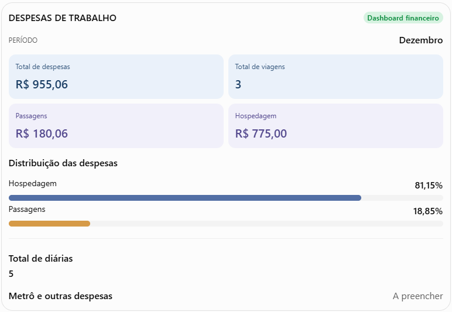

# Desenvolvimento do MetricDash — Dashboard Financeiro de Despesas de Deslocamento para Trabalho Híbrido

Atue como um engenheiro de software especialista em Angular, TypeScript, arquitetura frontend, engenharia de software, visualização de dados e desenvolvimento de dashboards financeiros.

Quero desenvolver o **MetricDash**, uma aplicação frontend profissional, moderna, responsiva e preparada para evoluir como um sistema de gestão financeira pessoal.

O objetivo é controlar minhas despesas mensais relacionadas ao deslocamento de Jaú para São Paulo, onde trabalho em regime híbrido.

A aplicação deverá permitir cadastrar despesas, classificá-las por categorias, acompanhar gastos mensais e anuais, comparar períodos, controlar viagens e hospedagens e visualizar o custo total de cada deslocamento.

**IMPORTANTE:** O desenvolvimento deverá respeitar a arquitetura e a estrutura já estabelecidas no projeto. Não substituir configurações existentes sem necessidade e não implementar funcionalidades fora do escopo solicitado.

## 1. Objetivo da aplicação

Desenvolver um dashboard financeiro que permita controlar todas as despesas relacionadas às viagens de trabalho, incluindo:

- Passagem de ônibus (ida e volta).
- Hospedagem em hotéis.
- Metrô.
- Uber ou transporte por aplicativo.
- Ônibus urbano.
- Alimentação.
- Estacionamento.
- Outras despesas.

A aplicação deverá permitir adicionar, editar, consultar e excluir lançamentos, mantendo os indicadores, gráficos e resumos atualizados automaticamente.

O sistema deverá ser preparado para utilização contínua durante vários anos, permitindo consultar históricos e comparar diferentes períodos.

## 2. Estrutura de páginas e funcionalidades

### PÁGINA 1 — DASHBOARD

Criar uma página principal com visão consolidada das despesas financeiras.

**Indicadores (cards):**

- Total de despesas do mês selecionado.
- Total gasto com passagens.
- Total gasto com hospedagem.
- Total gasto com transporte urbano.
- Total gasto com alimentação.
- Quantidade de viagens realizadas.
- Quantidade de diárias de hotel.
- Média de gastos por viagem.
- Média mensal de despesas.

**Filtros:**

- Ano.
- Mês.
- Categoria.
- Tipo de despesa.

Os filtros deverão atualizar todos os indicadores e gráficos relacionados ao período selecionado.

**Gráficos:**

1. Despesas por categoria.
2. Evolução dos gastos mensais.
3. Comparativo entre passagens e hospedagens.
4. Despesas por viagem.
5. Distribuição percentual dos gastos por categoria.

**Regras de apresentação:**

- Os cards devem apresentar valores monetários no padrão brasileiro.
- Os gráficos devem possuir títulos, legendas e informações compreensíveis.
- Exibir mensagens adequadas quando não existirem dados.
- Evitar gráficos com informações duplicadas.
- Garantir que os filtros sejam consistentes entre os componentes.
- Preparar os componentes para receber dados de serviços sem acoplamento à implementação visual.

### PÁGINA 2 — LANÇAMENTOS

Criar uma página para gerenciamento dos lançamentos financeiros.

Implementar uma tabela com as seguintes colunas:

| Campo              | Descrição                             |
| ------------------ | ------------------------------------- |
| Data               | Data da despesa                       |
| Mês                | Derivado automaticamente da data      |
| Ano                | Derivado automaticamente da data      |
| Viagem             | Identificação da viagem relacionada   |
| Categoria          | Passagem, hospedagem, metrô etc.      |
| Descrição          | Detalhamento da despesa               |
| Origem             | Cidade ou local de origem             |
| Destino            | Cidade ou local de destino            |
| Quantidade         | Quantidade de passagens, diárias etc. |
| Valor unitário     | Valor individual                      |
| Valor total        | Calculado automaticamente             |
| Forma de pagamento | Cartão, Pix, dinheiro etc.            |
| Observações        | Informações adicionais                |

**Funcionalidades:**

- Cadastrar despesas.
- Editar despesas.
- Excluir despesas, solicitando confirmação.
- Consultar detalhes de um lançamento.
- Pesquisar por descrição.
- Filtrar por categoria, mês, ano e viagem.
- Ordenar os registros.
- Exibir totalizadores.
- Permitir paginação quando necessária.
- Validar campos obrigatórios.
- Exibir mensagens de sucesso e erro.

**Regras:**

- Mês e ano deverão ser derivados da data do lançamento.
- O valor total deverá ser calculado pela quantidade multiplicada pelo valor unitário.
- Categorias e formas de pagamento deverão utilizar opções previamente configuradas.
- A identificação da viagem deverá permitir relacionar despesas ao respectivo deslocamento.
- Não permitir valores negativos ou quantidades inválidas, salvo quando houver uma regra de negócio explícita para estornos.

### PÁGINA 3 — VIAGENS E HOSPEDAGENS

Criar uma página específica para gerenciamento das viagens de trabalho para São Paulo.

**Dados da viagem:**

- Número ou identificador da viagem.
- Mês.
- Data de ida.
- Data de retorno.
- Quantidade de dias.
- Origem.
- Destino.
- Observações.

**Dados de hospedagem:**

- Hotel.
- Data de check-in.
- Data de check-out.
- Quantidade de diárias.
- Valor da diária.
- Total da hospedagem.

**Dados de transporte:**

- Passagem de ida.
- Passagem de volta.
- Total das passagens.
- Metrô.
- Outras despesas de transporte.

**Resumo financeiro da viagem:**

- Total de hospedagem.
- Total de passagens.
- Total de transporte.
- Total de alimentação.
- Outras despesas.
- Custo total da viagem.

**Regras de negócio:**

- Calcular automaticamente a quantidade de diárias pela diferença entre check-in e check-out.
- Calcular o total da hospedagem.
- Calcular o total das passagens.
- Calcular o custo total da viagem.
- Permitir múltiplas hospedagens associadas à mesma viagem.
- Permitir múltiplos lançamentos de despesas associados à mesma viagem.
- Permitir mais de uma despesa da mesma categoria.
- Não duplicar valores quando uma viagem possuir vários lançamentos ou hospedagens.
- Permitir consultar todas as despesas relacionadas a uma viagem.

**IMPORTANTE:** Uma viagem poderá possuir várias despesas e mais de uma hospedagem. A modelagem deverá respeitar os relacionamentos entre viagem, hospedagem e lançamento financeiro, evitando duplicidade nos cálculos e totalizadores.

### PÁGINA 4 — RESUMO MENSAL

Criar uma página com consolidação financeira dos meses do ano selecionado.

Apresentar uma tabela com janeiro a dezembro e as seguintes informações:

- Total de passagens.
- Total de hospedagem.
- Total de metrô.
- Total de transporte.
- Total de alimentação.
- Outras despesas.
- Total geral do mês.
- Quantidade de viagens.
- Quantidade de diárias.

**Funcionalidades:**

- Seleção do ano.
- Consolidação automática dos lançamentos.
- Totalização por categoria.
- Total anual.
- Comparação entre meses.
- Identificação do mês com maior despesa.
- Identificação da categoria com maior participação nos gastos.

O resumo deverá ser calculado a partir dos registros financeiros, evitando manter valores duplicados ou divergentes em diferentes páginas.

### PÁGINA 5 — CONFIGURAÇÕES

Criar uma página para gerenciamento das informações utilizadas nos formulários.

Disponibilizar listas editáveis para:

- Categorias.
- Formas de pagamento.
- Hotéis.
- Meses, quando necessário.
- Tipos de transporte.

As configurações deverão alimentar os campos de seleção dos formulários.

Implementar validações para evitar categorias ou opções duplicadas quando aplicável.

## 3. Dados iniciais para cadastro — DEZEMBRO

Cadastrar os dados abaixo como exemplos iniciais de utilização da aplicação.

**Passagens de ônibus:**

| Descrição           |     Valor |
| ------------------- | --------: |
| Passagem de ida     |  R$ 85,40 |
| Passagem de volta   |  R$ 94,66 |
| Total das passagens | R$ 180,06 |

**Hospedagem:**

Valor da diária: R$ 155,00.

Cadastrar as seguintes hospedagens:

| Viagem | Check-in | Check-out | Diárias | Valor da diária |     Total |
| ------ | -------- | --------- | ------: | --------------: | --------: |
| 1      | 02/12    | 04/12     |       2 |       R$ 155,00 | R$ 310,00 |
| 2      | 09/12    | 11/12     |       2 |       R$ 155,00 | R$ 310,00 |
| 3      | 17/12    | 18/12     |       1 |       R$ 155,00 | R$ 155,00 |

**Resumo inicial de dezembro:**

- Total de passagens: R$ 180,06.
- Total de hospedagem: R$ 775,00.
- Total de diárias: 5.
- Total parcial de despesas: R$ 955,06.

Deixar os campos de metrô, alimentação e outras despesas disponíveis para preenchimento posterior.

**Não inventar valores para despesas que ainda não foram informadas.**

Os dados iniciais deverão ser cadastrados de forma estruturada, permitindo que sejam utilizados pelos componentes, indicadores e gráficos.

Atenção: utilizar um ano de referência configurável para os registros de dezembro, sem presumir um ano que não tenha sido informado.

## 4. Regras de negócio e cálculos automáticos

Implementar as seguintes regras:

1. O valor total de cada lançamento deverá ser calculado automaticamente pela quantidade multiplicada pelo valor unitário.
2. A quantidade de diárias deverá ser calculada pela diferença entre check-in e check-out.
3. O total mensal deverá somar todas as despesas daquele mês.
4. O total por categoria deverá ser atualizado automaticamente.
5. O resumo anual deverá consolidar todos os meses.
6. Os gráficos deverão acompanhar os filtros selecionados.
7. Novos lançamentos deverão atualizar os indicadores e totalizadores.
8. Evitar contagem duplicada de passagens, hospedagens e viagens.
9. Uma viagem poderá possuir múltiplos lançamentos e hospedagens.
10. O custo total da viagem deverá considerar todos os registros relacionados, uma única vez.
11. Os cálculos financeiros deverão utilizar uma representação numérica consistente, preferencialmente valores em centavos para evitar imprecisões comuns em operações com ponto flutuante.
12. As datas deverão ser tratadas de maneira consistente, evitando problemas de fuso horário.
13. Os filtros deverão funcionar em conjunto.
14. O histórico de anos anteriores deverá permanecer consultável.
15. Os dados exibidos no dashboard deverão ser derivados de uma fonte de dados consistente.

**Arquitetura dos cálculos:**

- Centralizar regras de negócio em serviços ou funções específicas.
- Evitar cálculos financeiros complexos diretamente nos templates.
- Evitar duplicar regras entre páginas.
- Separar a responsabilidade de apresentação da responsabilidade de cálculo.
- Criar funções reutilizáveis para consolidação mensal, anual, por categoria e por viagem.
- Utilizar tipagem forte no TypeScript.

## 5. Design e identidade visual

A aplicação deverá seguir a identidade visual do MetricDash, com aparência corporativa, moderna, elegante e minimalista.

**Diretrizes visuais:**

- Tema inicial Dark.
- Preparação estrutural para tema Light.
- Superfícies organizadas em níveis visuais.
- Cards para indicadores financeiros.
- Gráficos limpos e fáceis de interpretar.
- Tabelas com boa hierarquia visual.
- Formulários organizados e intuitivos.
- Navegação clara entre as páginas.
- Ícones consistentes.
- Espaçamentos padronizados.
- Bordas e sombras discretas.
- Responsividade para desktop, tablet e dispositivos móveis.

**Paleta semântica inicial do tema Dark:**

- Fundo principal: `#171725`.
- Superfícies principais: `#242438`.
- Superfícies secundárias: `#2D2D43`.
- Bordas: `#38384F`.
- Texto principal: `#FDF7FE`.
- Texto secundário: `#B8B8CC`.
- Destaque rosa: `#E7ABD8`.
- Fundo de ícones: `#4A3D54`.
- Azul principal: `#17B4DA`.
- Azul profundo: `#17405B`.
- Amarelo: `#FFC506`.
- Vermelho: `#E94D4D`.

**Diretrizes para os temas:**

- Utilizar CSS Custom Properties.
- Centralizar os tokens semânticos nos arquivos de tema.
- Manter os mesmos nomes de tokens nos temas Dark e Light.
- Utilizar `data-theme` para identificar o tema ativo.
- Não inserir cores diretamente nos componentes.
- Não implementar um seletor de tema nesta etapa, salvo solicitação explícita.
- Garantir contraste e legibilidade.

**Formatação:**

- Valores monetários: R$ 1.234,56.
- Datas: DD/MM/AAAA.
- Localidade: pt-BR.
- Percentuais com casas decimais adequadas.
- Indicadores positivos, negativos e neutros com diferenciação visual consistente.

## 6. Requisitos técnicos e arquitetura frontend

Utilizar a estrutura técnica já definida para o MetricDash.

**Stack principal:**

- Angular na versão estável mais recente já definida no projeto.
- TypeScript com modo strict.
- SCSS.
- Componentes standalone.
- NG-ZORRO para componentes de interface, respeitando a versão compatível com Angular.
- NgRx para gerenciamento de estado quando necessário, utilizando versões compatíveis.
- Jest para testes unitários.
- ESLint para análise estática.
- Playwright para automação de navegador e preparação de capturas de tela.
- Open Sans como tipografia principal.

**Organização:**

Respeitar a separação existente entre:

- `core`: serviços, interceptors, models, types e enums.
- `shared`: componentes e tipos compartilhados.
- `pages`: dashboard, login, logout, lançamentos, viagens e hospedagens, resumo mensal e configurações.
- `styles`: abstracts, base, themes e estilos globais.
- `environments`: configurações de ambiente.

Antes de criar novas pastas ou arquivos, verificar a estrutura atual e seguir os padrões existentes.

**Responsabilidades:**

- Componentes: apresentação e interação com o usuário.
- Serviços: acesso e manipulação dos dados.
- Models e types: contratos e estruturas tipadas.
- Enums: valores padronizados.
- Estado: compartilhamento e atualização de informações quando necessário.
- Funções de domínio: regras e cálculos financeiros reutilizáveis.

**Requisitos de qualidade:**

- Não utilizar `any`.
- Evitar componentes excessivamente grandes.
- Evitar lógica de negócio nos templates.
- Evitar duplicação de código.
- Utilizar tipagem explícita.
- Utilizar nomes claros e consistentes.
- Garantir acessibilidade básica.
- Implementar estados de carregamento, sucesso, vazio e erro.
- Manter a aplicação responsiva.
- Criar testes unitários para as regras financeiras.
- Testar os relacionamentos entre viagens, hospedagens e lançamentos.

## 7. Persistência e gerenciamento de dados

A implementação deverá respeitar o escopo frontend definido para a etapa atual.

**Não implementar backend, API ou banco de dados sem autorização explícita.**

Enquanto não existir uma API definida, utilizar uma camada de persistência local apropriada, mantendo a lógica de acesso isolada em serviços.

A persistência local deverá:

- Permitir cadastrar, editar e excluir despesas.
- Preservar os registros entre atualizações da página.
- Permitir armazenar viagens e hospedagens.
- Manter relacionamentos consistentes.
- Tratar ausência de dados.
- Possibilitar a inclusão dos dados iniciais.
- Evitar duplicação dos registros iniciais em carregamentos posteriores.

A arquitetura deverá permitir substituir futuramente a implementação local por uma API, sem exigir reescrita dos componentes de apresentação.

Não armazenar dados sensíveis ou credenciais.

## 8. Requisitos de testes e validação

Criar testes unitários para validar:

- Cálculo do valor total de um lançamento.
- Cálculo da quantidade de diárias.
- Cálculo do total de hospedagem.
- Cálculo do total de passagens.
- Consolidação de despesas mensais.
- Consolidação anual.
- Totalização por categoria.
- Totalização por viagem.
- Relacionamento de múltiplas despesas com uma viagem.
- Prevenção de valores duplicados.
- Aplicação simultânea de filtros.
- Tratamento de valores e datas inválidos.

Validar os dados iniciais de dezembro:

- Passagens: R$ 180,06.
- Hospedagem: R$ 775,00.
- Diárias: 5.
- Total parcial: R$ 955,06.

Executar os testes, lint e build disponíveis no projeto antes de considerar a implementação concluída.

Não afirmar que um teste foi executado ou aprovado sem realmente executá-lo.

## 9. Escopo e limites da implementação

Implementar as funcionalidades financeiras descritas neste documento somente quando a etapa de desenvolvimento funcional for autorizada.

Respeitar a separação entre configuração inicial e desenvolvimento das funcionalidades.

Não implementar funcionalidades adicionais sem necessidade ou autorização, como:

- Integração bancária.
- Importação automática de extratos.
- Inteligência artificial.
- Previsão de gastos.
- Conversão de moedas.
- Integração com serviços externos.
- Backend.
- Banco de dados remoto.
- Autenticação real.
- Exportação de relatórios.
- Notificações financeiras.

Não alterar configurações, dependências ou estruturas existentes sem avaliar o impacto e explicar a necessidade.

## 10. Resultado esperado

Quero abrir o MetricDash e visualizar imediatamente:

- Quanto gastei no mês selecionado.
- Quanto gastei com passagens.
- Quanto gastei com hospedagem.
- Quanto estou gastando com metrô.
- Quanto custa cada viagem para São Paulo.
- Quanto gasto mensalmente para trabalhar presencialmente.
- Quanto gastei no acumulado do ano.
- Qual categoria representa a maior parte das despesas.
- Como meus gastos evoluíram ao longo dos meses.
- Qual foi o custo individual de cada viagem.

A aplicação deverá funcionar como um sistema de gestão financeira pessoal, com interface consistente, dados organizados, cálculos confiáveis e arquitetura preparada para evoluir.

**O resultado deverá ser um frontend Angular funcional, responsivo, tipado, testável e organizado, respeitando todas as regras de negócio descritas neste documento.**

## 11. Orientações para execução

Antes de iniciar qualquer implementação:

1. Analisar a estrutura atual do repositório.
2. Verificar as dependências e versões instaladas.
3. Identificar os componentes e serviços já existentes.
4. Conferir as rotas e os padrões de organização.
5. Verificar os arquivos de tema e os tokens visuais.
6. Apresentar o planejamento da implementação.
7. Identificar possíveis conflitos com o código existente.
8. Aguardar autorização quando houver necessidade de alterar algo fora do escopo.

Durante a implementação:

- Executar uma etapa por vez.
- Manter a documentação atualizada.
- Não sobrescrever arquivos sem necessidade.
- Não remover funcionalidades existentes.
- Validar cada etapa antes de avançar.
- Registrar decisões técnicas relevantes.
- Manter o código consistente com os padrões do projeto.

**Não presumir requisitos não informados. Quando houver dúvida sobre uma regra financeira ou comportamento esperado, apresentar a dúvida antes de implementar.**

### COMO IRÁ FICAR O RESULTADO ESPERADO:

